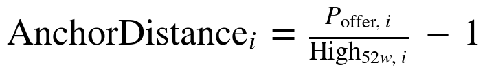
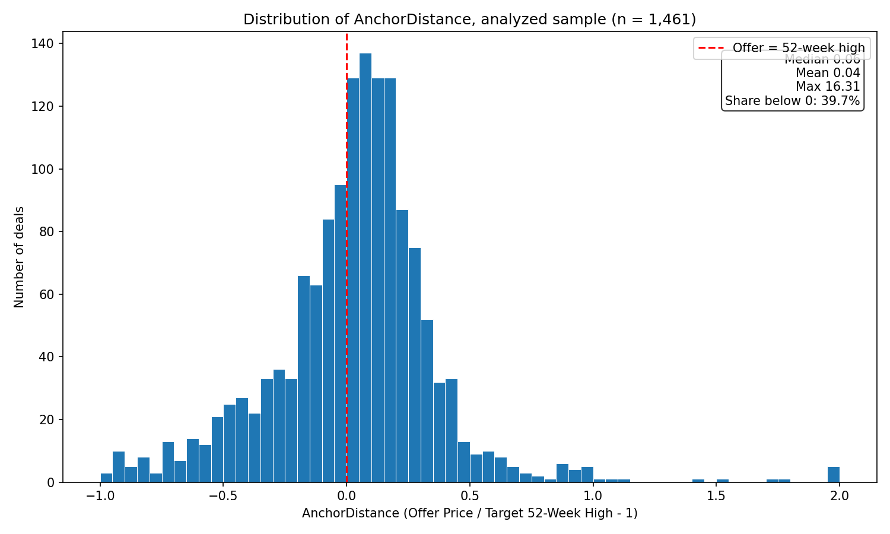
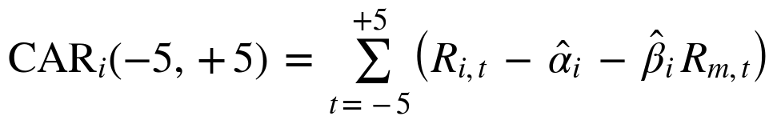
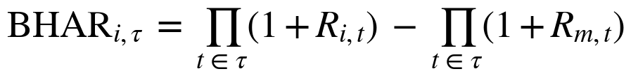
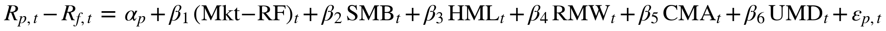
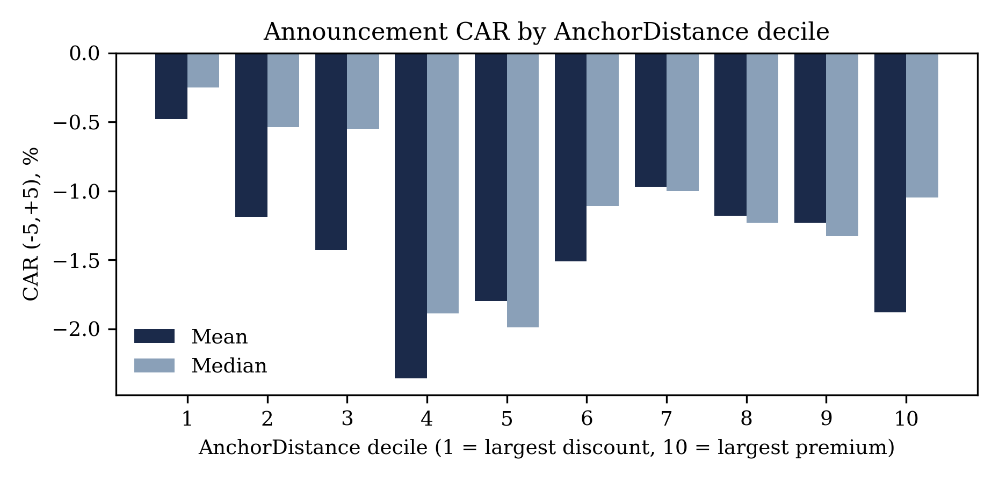
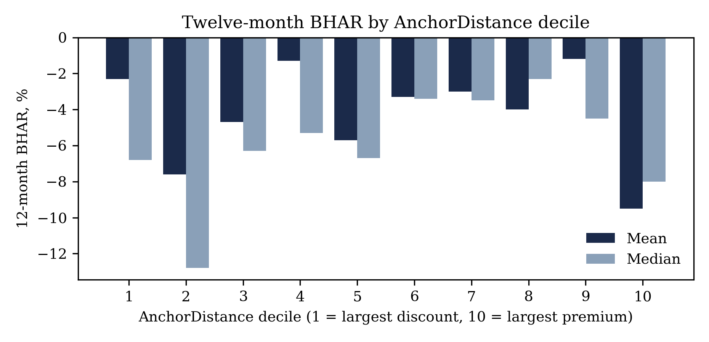
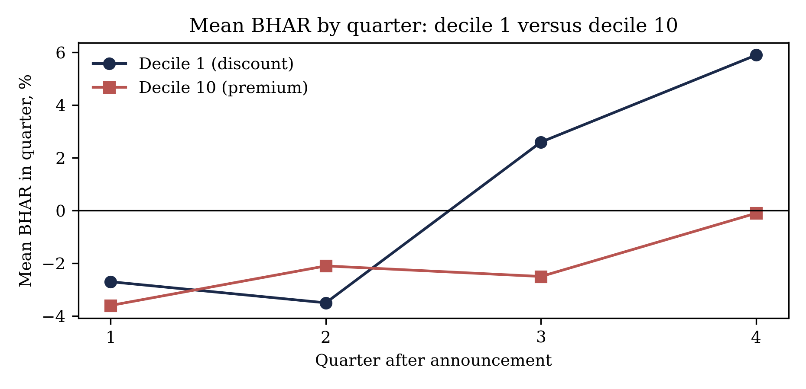

# The Target’s 52-Week High as an Anchor in Mergers and Acquisitions

*Announcement and Twelve-Month Acquirer Returns, 2005–2025*

Abhibroto Mukherjee \| University of Chicago Booth School of Business \| Behavioral Finance (Prof. Robert Vishny) \| December 2, 2026

**Abstract**

Anchoring of merger offer prices on the target firm’s trailing 52-week high is well documented (Baker, Pan, and Wurgler, 2012) and taken as established here. This paper investigates whether the signed distance between the offer price paid and that salient reference price predicts short- and long-horizon acquirer stock returns. Using a sample of 1,461 completed United States public-to-public acquisitions announced between 2005 and 2025, I sort acquirers into deciles by AnchorDistance, defined as the offer price divided by the target’s pre-run-up 52-week high minus one. Announcement cumulative abnormal returns, CAR(−5,+5), are negative across all ten deciles, least negative in Decile 1 (−0.48%, t = −0.43) and most negative in Decile 4 (−2.36%, t = −3.65); the Decile 1 minus Decile 10 spread is +1.39 percentage points and statistically insignificant (p = 0.302). Twelve-month buy-and-hold abnormal returns (BHAR) are likewise negative in every decile. Extreme premium payers in Decile 10 suffer severe, statistically robust underperformance (−9.52%, t = −4.37, p \< 0.001), whereas deep-discount buyers in Decile 1 exhibit an insignificant mean return (−2.31%, t = −0.47) alongside a sharply negative median (−6.83%). Quarterly decompositions show that Decile 10’s underperformance is front-loaded and persistent, while Decile 1 recovers only in the second half of the post-announcement year, a pattern that does not survive a Holm multiple-testing correction (p_Holm = 0.238). These findings corroborate Baker, Pan, and Wurgler (2012) on the cost of bidding far above the target’s peak, diverge from the reversal pattern documented by Ma, Whidbee, and Zhang (2019) for the acquirer’s own 52-week high, and remain subject to the momentum confound identified by George and Hwang (2004).

## 1. Introduction

When a corporate board evaluates an acquisition, the offer price is rarely judged in isolation. Instead, negotiators, arbitrageurs, and shareholders evaluate it against a salient public benchmark: the highest price at which the target’s stock has traded over the preceding twelve months. Because the 52-week high is highly visible, easily recalled, and straightforward to invoke in boardroom bargaining, it serves as a powerful psychological reference point. Prior literature establishes that merger offer prices cluster strongly at and immediately above this peak (Baker, Pan, and Wurgler, 2012). Taking that clustering as given, this paper examines the valuation consequences for acquiring shareholders: whether acquirers that pay far above the target’s 52-week high earn lower abnormal returns, both at deal announcement and over the subsequent twelve months, than acquirers that transact near or below it.

Building directly on Baker, Pan, and Wurgler (2012), who show that the component of the bid premium driven by the target’s 52-week peak predicts lower bidder announcement returns, I ask two related empirical questions. First, is the pricing distortion associated with distance from the target’s 52-week high fully impounded at announcement, or does it unfold gradually over the subsequent year? Second, is the return relationship symmetric across the two tails of the anchor distribution? Bidding well above the target’s peak may reflect competitive hubris or anchoring-induced overpayment, whereas bidding substantially below the peak may indicate either disciplined bargain hunting or the acquisition of an operationally distressed firm. Because the economic forces governing the two tails differ fundamentally, this study analyzes the full decile distribution rather than imposing a single linear slope.

To test these questions, I examine 1,461 completed United States public-to-public mergers and acquisitions announced from January 2005 through December 2025. This twenty-one-year window extends nearly two decades beyond the 1984–2007 sample of Baker, Pan, and Wurgler (2012), spanning the 2008 financial crisis, the post-crisis merger expansion, the COVID-19 shock, and the subsequent monetary tightening cycle. For each transaction, I measure AnchorDistance as the ratio of the offer price to the target’s pre-run-up 52-week high, minus one, and sort deals into ten equal-sized deciles. Decile 1 comprises deep-discount buyers whose offers sit farthest below the target’s peak; Decile 10 comprises extreme premium payers whose offers sit farthest above it. I then evaluate acquirer market-model cumulative abnormal returns over the eleven-day announcement window, CAR(−5,+5), and compounded buy-and-hold abnormal returns (BHAR) over the four post-announcement quarters and the full twelve-month horizon.

The central empirical finding is a pronounced tail asymmetry. At announcement, acquirers experience negative average abnormal returns in all ten deciles, ranging from −0.48% in Decile 1 to −2.36% in Decile 4. While the extreme spread between Decile 1 and Decile 10 is positive (+1.39 percentage points on the mean and +0.80 points on the median), it is statistically indistinguishable from zero (Welch t = 1.03, p = 0.302), and the cross-decile profile is non-monotonic: interior Deciles 4 and 5 experience worse announcement reactions than Decile 10. Short-window announcement returns therefore offer only weak, noisy support for a directional anchor contrast and provide no basis for a monotonic trading rule.

Over the twelve-month post-announcement horizon, however, the extreme premium payers separate sharply from the rest of the distribution, whereas discount buyers do not. Twelve-month mean BHAR is negative across every decile, from −1.20% in Decile 9 to −9.52% in Decile 10. Decile 10 is the worst-performing bucket on the raw mean (−9.52%, t = −4.37, p \< 0.001), the median (−7.96%), and the 1%/99% winsorized mean (−9.28%). By contrast, Decile 1 posts a statistically insignificant mean BHAR of −2.31% (t = −0.47, p = 0.640) alongside a negative median of −6.83% and a winsorized mean of −5.64%. Consequently, the headline Decile 1 minus Decile 10 mean spread of +7.21 percentage points shrinks to +1.13 points at the median and +3.63 points on the winsorized mean, failing standard significance thresholds (Welch t = 1.34, p = 0.181; bootstrap 95% confidence interval −2.67 to +18.25 points). Right-tail skewness in Decile 1 (SD = 58.57%, more than double that of any other decile) inflates its mean without rescuing the typical discount acquirer. The empirical evidence thus supports a robust conclusion about overpayment, bidding far above the target’s 52-week high reliably predicts sustained acquirer underperformance, rather than a profitable long-short anomaly.

A quarterly decomposition clarifies the timing of this divergence. In Quarter 1, both tails lose ground: Decile 1 earns −2.68% (t = −1.28) and Decile 10 earns −3.62% (t = −3.13, p = 0.002). Thereafter, the tails diverge. Decile 10 remains negative in every single quarter, suffering additional significant losses in Quarter 3 (−2.53%, p = 0.033) and never rebounding. Decile 1 remains negative through Quarter 2 (−3.48%, p = 0.080) before turning positive on the mean in Quarter 3 (+2.57%) and Quarter 4 (+5.90%, t = 1.99, p = 0.049). The Decile 1 minus Decile 10 spread becomes positive and marginally significant only in Quarter 4 (+5.98 percentage points, Welch t = 1.90, p = 0.059; bootstrap 95% interval +0.08 to +12.43 points), and loses statistical significance once adjusted across the four quarters via the Holm procedure (p_Holm = 0.238). Any recovery among discount buyers arrives late and remains statistically tentative.

These results align with Baker, Pan, and Wurgler (2012) in showing that clearing the target’s 52-week high by a wide margin destroys bidder value, while extending their evidence by demonstrating that most of the penalty unfolds over the twelve months following announcement rather than instantaneously in the event window. At the same time, the findings underscore the methodological warning of George and Hwang (2004): because proximity to the 52-week high captures cross-sectional momentum, unconditional sorts on AnchorDistance partially reflect pre-deal return trajectories. Finally, the results contrast instructively with Ma, Whidbee, and Zhang (2019), who examine anchoring on the acquirer’s own 52-week high and document short-run reaction followed by long-run reversal, a reversal absent when anchoring is measured against the target’s peak.

## 2. Literature Review and Hypothesis Development

Anchoring-and-adjustment is a foundational heuristic in judgment under uncertainty: quantitative estimates are systematically pulled toward salient initial values, even when those reference values are economically uninformative. Reference-dependent evaluation in turn holds that agents evaluate outcomes as gains or losses relative to a reference point and exhibit sharp loss aversion below that threshold \[Tversky and Kahneman (1974)\]. In corporate takeovers, a target’s trailing 52-week high provides a natural, mutually observable reference point. For target directors and shareholders, the past year’s peak represents a salient benchmark of recent value, making offers below that level feel like realized losses. For acquiring managers, bidding at or above the target’s 52-week high can be rationalized as the price required to secure board approval quickly and deter competing bidders.

Baker, Pan, and Wurgler (2012) provide the seminal empirical evidence on 52-week high anchoring in mergers and acquisitions. Examining United States deals from 1984 to 2007, they document a sharp spike in the distribution of offer prices right at and immediately above the target’s 52-week high, clustering that cannot be explained by fundamental valuation models because a trailing peak is a backward-looking statistic. Decomposing the offer premium into a component predicted by the distance between the target’s pre-announcement price and its 52-week high and an orthogonal residual, they show that the anchor-driven premium component negatively predicts acquirer announcement returns. Their economic interpretation is straightforward: reference-point bargaining forces bidders to pay higher prices without generating commensurate synergy gains, and equity markets recognize at least part of that overpayment upon announcement. This study adopts their reference price and economic intuition while maintaining a strict conceptual distinction between a standard takeover premium (measured relative to the target’s recent trading price) and AnchorDistance (measured relative to the target’s trailing 52-week peak).

George and Hwang (2004) provide the primary alternative asset-pricing benchmark and the main empirical discipline for this investigation. They show that the ratio of a stock’s current price to its 52-week high strongly predicts future cross-sectional returns and subsumes much of the explanatory power of conventional price momentum, arguing that investors anchor on the 52-week high and under-react to good news when prices trade near their peaks. For merger studies, the implication is immediate: sorting deals by the ratio of the offer price to the target’s 52-week high is mechanically correlated with the target’s pre-announcement price trajectory. Targets sold at deep discounts to their 52-week high (low AnchorDistance) have typically suffered steep prior price declines, a regime associated with distressed firm performance and negative return continuation (George and Hwang, 2004), whereas targets acquired near or above their peaks have experienced strong prior momentum. Consequently, unconditional return patterns across AnchorDistance deciles cannot be attributed purely to deal-negotiation anchoring until benchmarked against factor and momentum controls in a calendar-time framework.

Three additional theories of acquisition pricing inform the competing explanations evaluated in Section 8. First, the hubris hypothesis posits that acquiring managers overestimate their ability to extract synergies and fall prey to the winner’s curse in competitive bidding, resulting in systematic overpayment. Second, the CEO overconfidence account holds that overconfident CEOs undertake more frequent and value-destroying acquisitions, eliciting significantly more negative market reactions at announcement. Third, the misevaluation account models acquisitions driven by relative stock market misevaluation, predicting that overvalued acquirers use equity as currency to acquire less overvalued targets, which induces long-run post-merger stock underperformance concentrated in stock-financed deals.

Taking reference-point anchoring in deal pricing as established, this paper tests two hypotheses regarding the cross-sectional effect of AnchorDistance on acquirer shareholder wealth:

> **Hypothesis 1a (Short-Window Announcement Effect):** Acquirers offering prices far above the target’s pre-run-up 52-week high (high AnchorDistance) earn significantly lower announcement cumulative abnormal returns, CAR(−5,+5), than acquirers offering prices near or below that peak (low AnchorDistance).
>
> **Hypothesis 1b (Long-Horizon Post-Announcement Drift):** The valuation penalty associated with bidding far above the target’s 52-week high is not fully impounded at announcement, causing extreme premium payers (Decile 10) to underperform discount buyers (Decile 1) over the subsequent twelve months.

Hypothesis 1b is formulated as a relative tail comparison rather than a claim of positive absolute alpha. Because public-target acquirers earn negative average abnormal returns across most large historical samples, finding that Decile 10 suffers severe, statistically significant underperformance while Decile 1 suffers little or no average loss constitutes meaningful evidence of an asymmetric anchoring penalty, even if it does not establish an implementable long-short trading strategy.

## 3. Conceptual Distinction from Ma, Whidbee, and Zhang (2019)

Ma, Whidbee, and Zhang (2019), “Acquirer Reference Prices and Acquisition Performance,” is the study closest in spirit to this paper. Both papers investigate how proximity to a 52-week high reference price shapes merger returns, yet they examine fundamentally different anchors, leading to distinct behavioral mechanisms and opposite post-announcement return trajectories.

**1. Identity of the Reference Point:** Ma, Whidbee, and Zhang (2019) examine the acquirer’s own 52-week high, measuring where the bidder’s pre-announcement stock price stands relative to its trailing peak. Their mechanism operates through bidder-side psychology and investor perception of the acquirer’s valuation. By contrast, this paper examines the target’s 52-week high, comparing the offer price paid for the target against the target’s trailing peak. Here, the behavioral friction operates through bilateral price negotiation: the target’s past high anchors the seller’s reservation price and defines the threshold the bidder must clear to consummate the deal. One anchor prices the buyer’s currency; the other prices the asset being acquired.

**2. Direction and Persistence of Post-Announcement Returns:** Ma, Whidbee, and Zhang (2019) find that acquirers trading well below their own 52-week high earn higher announcement returns than acquirers trading near their own high, and that this announcement differential reverses over the subsequent twelve months, indicating an initial market overreaction that subsequently corrects. No comparable reversal emerges for the target’s 52-week high. In the present sample, extreme premium payers (Decile 10) are penalized at announcement (CAR = −1.88%, p = 0.011) and deteriorate further over the next year (BHAR = −9.52%, p \< 0.001), with significantly negative returns in Quarters 1 and 3 and zero rebound in Quarter 4. Meanwhile, deep-discount buyers (Decile 1) experience neither a significant announcement gain nor a significant twelve-month gain, exhibiting only a late fourth-quarter bounce that fails multiple-testing correction.

**3. Non-Parametric Distribution vs. Linear Slopes:** Whereas Ma, Whidbee, and Zhang (2019) rely primarily on linear regression specifications of announcement and post-merger returns on the acquirer’s reference-price ratio, this paper presents the full ten-decile distribution alongside medians, 1%/99% winsorized means, and quarterly decompositions with Welch, permutation, and bootstrap inference. Examining the entire decile grid reveals sharp non-monotonicities, such as the announcement trough in Deciles 4 and 5 and the twelve-month distress dip in Decile 2, that a single linear regression slope would obscure.

**4. Sample Regime:** Ma, Whidbee, and Zhang (2019) analyze an earlier historical sample, whereas this paper evaluates completed United States public-to-public transactions announced between 2005 and 2025. Concurrence with Baker, Pan, and Wurgler (2012) and divergence from Ma, Whidbee, and Zhang (2019) are mutually consistent precisely because the two studies measure distinct economic anchors.

## 4. Data, Sample Construction, and Return Measurement

### 4.1 Sample Construction and Anchor Measurement

Merger and acquisition records are obtained from Refinitiv SDC Platinum via Wharton Research Data Services (WRDS). The initial extraction comprises 5,978 records for completed United States public-to-public transactions announced between January 1, 2005 and December 31, 2025, including stake-acquisition fields (pctacq and pctown). Removing 34 duplicate rows yields 5,944 distinct deals; all source records are preserved intact and exclusion filters are implemented via indicator flags.

Daily stock returns, closing prices, shares outstanding, and delisting returns are obtained from the Center for Research in Security Prices (CRSP) via WRDS, and daily and monthly asset-pricing factors are retrieved from the Kenneth French Data Library. Requiring valid CRSP permanent security identifiers (PERMNO) for both the target and the acquirer reduces the sample from 5,944 to 3,851 matched deals. This matching criterion tilts the sample toward larger, exchange-listed, liquid public corporations with continuous trading histories, and empirical inferences should be interpreted as specific to public-to-public transactions rather than small or private-target acquisitions.

Following Baker, Pan, and Wurgler (2012), the target’s reference peak, High_52w, is defined as the maximum CRSP daily closing price over the calendar window \[−400, −21\] days relative to the SDC announcement date. Truncating the window 21 calendar days before announcement prevents pre-bid rumor run-ups from contaminating the reference price. The offer price is taken directly from the SDC-reported offer price (pr) where available; when pr is missing, an implied offer price is constructed as (Deal Value × 1,000) / Target Shares Outstanding. For each transaction i, the signed distance from the target’s 52-week peak is defined as:

 (1)

An AnchorDistance of 0.00 indicates an offer exactly equal to the target’s pre-run-up 52-week high; −0.50 indicates an offer at half the peak; and +0.25 indicates an offer 25% above the peak. Deals are sorted into ten deciles of AnchorDistance, where Decile 1 represents the largest discount below the 52-week high and Decile 10 represents the largest premium above it.

Figure 1 shows the distribution of AnchorDistance for the 1,461 analyzed deals. The distribution is not a bell curve: it is concentrated near zero, with most offers clustered at or just above the target’s 52-week high, and it has a long right tail of offers far above the high, extending to a maximum of 16.31. The left tail is bounded below by −1 by construction and is thin at its extreme: only 13 deals sit below −0.90. In total, 580 deals (39.7%) price below the 52-week high and 879 price above it, with two deals priced exactly at it.

*Figure 1. Distribution of AnchorDistance for the 1,461 analyzed deals. AnchorDistance = (Offer Price / Target 52-Week High) − 1. Median 0.06, mean 0.04, minimum −0.99, maximum 16.31. 580 deals fall below zero and 879 fall above zero. The red dashed line at zero marks where the offer equals the 52-week high.*

### 4.2 Data Hygiene: Same-Company and Partial-Stake Artifacts

Two structural data artifacts identified during sample construction warrant explicit documentation:

**1. Same-Company Restructuring Artifact:** In the initial CRSP-matched pool of 3,851 transactions, 2,251 records shared an identical PERMNO for both target and acquirer. Inspection confirmed that these observations represent internal corporate restructurings, recapitalizations, dual-class share conversions, or tracking-stock exchanges rather than arm’s-length third-party acquisitions. Because such internal restructurings frequently carry nominal per-share valuations far below trailing market highs, they clustered overwhelmingly in the left tail: 361 of the original 368 deals in Decile 1 were same-company transactions with a median AnchorDistance of −0.916 (compared to +0.049 for distinct-company deals). Retaining them would have fabricated an artificial discount tail out of corporate reorganizations. Restricting the sample to transactions where the target and acquirer PERMNOs differ and requiring non-missing AnchorDistance yields approximately 1,564 eligible third-party deals, from which the final return sample of 1,461 deals is constructed (147 deals in Decile 1 and 146 deals in each of Deciles 2 through 10, as reported in Table 1).

**2. Partial-Stake Offer-Price Artifact:** When SDC omits pr in a partial-stake acquisition, dividing total deal value by the target’s entire share count understates the true per-share price paid for the acquired stake and shifts the observation toward Decile 1. Spot checks of an earlier sample build confirmed this mechanism in minority investments, for example, Abbott Laboratories’ 2006 purchase of Boston Scientific shares at \$25.00 per share (implied filled price \$1.71), Bank of America’s 2007 preferred investment in Countrywide at \$18.00 per share for an approximately 15% stake (filled price \$3.48), and PepsiCo’s 2022 investment in Celsius convertible preferred at \$75.00 per share for an 8.5% stake (filled price \$7.27). Although a subsequent WRDS extraction retrieved pctacq and pctown across all 5,978 rows, allowing a stake-adjusted price of (Deal Value × 100,000) / (Shares Outstanding × pctacq), the present baseline sample retains the unadjusted composite price. Its empirical footprint in the verified final sample is minimal: out of 147 deals in Decile 1, 136 rely on SDC reported prices and only 11 rely on filled prices (down from 42 in an earlier build), and none of the minority investments noted above remains in the sample. Section 9 evaluates the direction of any residual bias and outlines the stake-corrected robustness check.

### 4.3 Estimation of Announcement CAR and Long-Horizon BHAR

Short-window announcement returns are estimated via a standard market model. For each acquirer i, daily stock returns are regressed on the daily value-weighted market return, constructed from the Kenneth French Data Library as (Mkt−RF + RF) / 100, over the estimation window from −252 to −31 trading days relative to the event date t = 0 (defined as the first trading day on or after the SDC announcement date, without after-hours timestamp adjustment). Cumulative abnormal returns over the eleven-day window \[−5, +5\] are computed as:

 (2)

Deals are required to have at least 100 non-missing estimation-window observations and complete return coverage across all eleven event days, yielding 1,441 valid CAR observations out of 1,461 deals (17 exclusions due to insufficient estimation observations and 3 due to missing event-window returns).

Long-horizon post-announcement performance is measured via buy-and-hold abnormal returns (BHAR), compounding daily acquirer returns (incorporating CRSP delisting returns where available) less the compounded market return over identical holding dates for each post-announcement quarter (Q1 through Q4) and the full twelve-month horizon:

 (3)

Of the 1,461 sample transactions, 1,432 possess complete twelve-month return windows (ranging from 141 to 146 deals per decile in Table 1), while 29 are truncated prior to twelve months. Because long-run BHAR distributions exhibit substantial right skewness and cross-sectional dependence, every decile and horizon is evaluated using four complementary statistics, the raw mean, the median, the standard deviation, and the (1%/99%) winsorized mean, and no inference relies solely on unadjusted parametric means.

## 5. Short-terms Announcement Returns: Uniform Value Destruction and Non-Monotonicity

Table 3 reports eleven-day announcement CAR(−5,+5) across all ten AnchorDistance deciles. Consistent with the broader pattern in public-to-public acquisitions, acquirer shareholders experience negative average announcement returns in every single decile. Mean CAR(−5,+5) is −0.48% in Decile 1 (t = −0.43, p = 0.669), −1.19% in Decile 2 (t = −1.35, p = 0.179), −1.43% in Decile 3 (t = −1.87, p = 0.064), −2.36% in Decile 4 (t = −3.65, p \< 0.001), −1.80% in Decile 5 (t = −2.65, p = 0.009), −1.50% in Decile 6 (t = −2.38, p = 0.019), −0.97% in Decile 7 (t = −1.76, p = 0.081), −1.18% in Decile 8 (t = −1.67, p = 0.097), −1.23% in Decile 9 (t = −1.99, p = 0.049), and −1.88% in Decile 10 (t = −2.57, p = 0.011). Eight of the ten deciles exhibit statistically significant announcement losses at the 10% level or better, with Decile 1 standing out as the mildest and least precisely estimated bucket (SD = 13.55%).

Table 5 evaluates the long-short spread between the extreme deciles. The Decile 1 minus Decile 10 announcement spread is +1.39 percentage points on the mean, +0.80 points at the median, and +1.00 point on the winsorized mean. While the positive sign aligns with Hypothesis 1a and Baker, Pan, and Wurgler (2012), the difference is statistically indistinguishable from zero: the two-sample Welch t-statistic is 1.03 (p = 0.302), the permutation p-value is 0.295, and the 95% bootstrap confidence interval spans −1.16 to +4.06 percentage points. Pooling the outer decile pairs (Deciles 1–2 minus Deciles 9–10) attenuates the mean spread further to +0.71 percentage points (Welch t = 0.83, p = 0.406).

A pure linear anchoring gradient predicts that bidder announcement returns deteriorate steadily as AnchorDistance rises from Decile 1 to Decile 10. Instead, returns worsen sharply from Decile 1 (−0.48%) to a trough in Decile 4 (−2.36%) and Decile 5 (−1.80%), recover through Decile 7 (−0.97%), and deteriorate again into Decile 10 (−1.88%). Economically, AnchorDistance appears to partition transactions into heterogeneous deal regimes: steep discounts (Decile 1) where investors may perceive disciplined bargain pricing despite elevated dispersion; mid-discount deals (Deciles 4–5) involving targets that have pulled back moderately from recent peaks and may be acquired amid operating headwinds; and aggressive offers far above the 52-week peak (Decile 10) penalized for overpayment. Because an unconditional decile sort cannot disentangle target distress from bidder hubris at announcement, short-window evidence alone provides neither statistical significance nor a monotonic gradient.

## 6. Twelve-Month Acquirer Returns: Decile Separation and Tail Asymmetry

Table 4 reports twelve-month post-announcement BHAR by decile, and Table 2 summarizes the full decile-by-horizon grid. Across the full year following announcement, every decile again records a negative mean and negative median abnormal return, confirming that public-target acquisitions remain a net drag on bidder stock performance in the 2005–2025 era. However, the cross-sectional distribution reveals four distinct economic regimes across the ten deciles rather than a uniform linear slope:

**1. Discount Tail (Deciles 1 and 2, Outlier Skewness vs. Distressed Value Traps):** Decile 1 posts a seemingly mild twelve-month mean BHAR of −2.31% (t = −0.47, p = 0.640), ranking third-best on the raw mean. Yet its median is −6.83% and its 1%/99% winsorized mean falls to −5.64%. Decile 1’s cross-sectional standard deviation is 58.57%, more than double the 25.30%–35.68% dispersion observed in Deciles 2 through 10, demonstrating that a handful of extreme right-tail winners pull the raw mean upward while the typical discount acquirer underperforms the market substantially. Immediately adjacent, Decile 2 suffers the second-worst mean BHAR (−7.58%, t = −2.52, p = 0.013) and the worst median (−12.76%) in the entire dataset. Targets willing to accept offers far below their 52-week peak frequently suffer from severe operational or competitive deterioration; consistent with the evidence on distressed acquisitions and with George and Hwang (2004) on negative return continuation far below the 52-week high, buyers in Decile 2 frequently catch falling knives.

**2. Unanchored Interior (Deciles 3 through 7, Baseline M&A Drag):** Across the middle five deciles, twelve-month mean BHAR ranges between −1.27% (Decile 4, t = −0.46) and −5.66% (Decile 5, t = −2.65, p = 0.009), averaging −3.60% with closely aligned raw and winsorized means. This interior average matches the baseline one-year public-target acquirer underperformance also reported by Ma, Whidbee, and Zhang (2019), reflecting routine post-merger integration friction in transactions priced at unremarkable discounts to the target’s trailing high.

**3. Focal-Point Sweet Spot (Deciles 8 and 9, Disciplined Anchor Clearance):** Decile 9 achieves the least negative twelve-month mean BHAR (−1.20%, t = −0.55, p = 0.580) and winsorized mean (−1.20%), while Decile 8 records the highest median BHAR (−2.27%; mean −4.04%, p = 0.081). As Baker, Pan, and Wurgler (2012) show, offer prices cluster tightly at and just above the target’s 52-week high because target boards treat that peak as their psychological reservation price. Acquirers landing in Deciles 8 and 9 acquire healthy companies trading near their highs and pay just enough to clear the seller’s anchor without succumbing to winner’s-curse overpayment.

**4. Overpayment Cliff (Decile 10, Severe, Robust Underperformance):** Crossing from Decile 9 into Decile 10 triggers an abrupt valuation cliff: the twelve-month mean BHAR drops by 8.32 percentage points (and the winsorized mean drops by 8.08 points) to −9.52% (t = −4.37, p \< 0.001), with a median of −7.96% and a winsorized mean of −9.28%. Decile 10 is the worst-performing bucket on every location metric, confirming that its collapse is broad-based rather than outlier-driven.

As shown in Table 5, the headline Decile 1 minus Decile 10 twelve-month spread of +7.21 percentage points fails statistical significance (Welch t = 1.34, p = 0.181; permutation p = 0.172; bootstrap 95% interval −2.67 to +18.25 points) and shrinks to +1.13 points at the median and +3.63 points on the winsorized mean. When the extreme buckets are pooled (Deciles 1–2 minus Deciles 9–10) to dampen single-decile noise, the mean spread vanishes to +0.46 percentage points (Welch t = 0.14, p = 0.889) and the median spread turns negative at −5.77 points.

The twelve-month empirical takeaway is therefore asymmetric and unambiguous: the robust statistical signal resides exclusively in Decile 10, not in a two-sided long-short spread. While discount acquisitions do not reliably generate outperformance, paying far above the target’s 52-week high reliably predicts severe acquirer underperformance over the subsequent year. Moreover, because Decile 10’s twelve-month loss (−9.52%) is roughly five times larger than its eleven-day announcement loss (−1.88%), equity markets appear to under-react initially to the full economic cost of anchor-driven overpayment.

## 7. Quarterly Post-Announcement Dynamics

Table 2 and Table 5 decompose the twelve-month BHAR into four consecutive post-announcement quarters, revealing when the two tails diverge:

**Quarter 1:** Both extreme deciles lose value immediately following announcement. Decile 1 earns a mean BHAR of −2.68% (t = −1.28, p = 0.201), while Decile 10 suffers a sharp, statistically significant drop of −3.62% (t = −3.13, p = 0.002). The Decile 1 minus Decile 10 spread is +0.94 percentage points and insignificant (Welch t = 0.39, p = 0.694).

**Quarter 2:** Weakness persists in both tails. Decile 1 declines by −3.48% (t = −1.76, p = 0.080) and Decile 10 declines by −2.14% (t = −1.89, p = 0.061), inverting the spread to −1.34 percentage points (Welch t = −0.59, p = 0.556).

**Quarter 3:** The two tails separate. Decile 10 continues to bleed, losing −2.53% (t = −2.15, p = 0.033), whereas Decile 1 turns positive on the mean at +2.57% (t = 0.87, p = 0.383), generating a spread of +5.10 percentage points (Welch t = 1.61, p = 0.108; bootstrap 95% interval −0.97 to +11.45 points).

**Quarter 4:** Decile 10 flattens at −0.09% (t = −0.08, p = 0.935), while Decile 1 posts a mean gain of +5.90% (t = 1.99, p = 0.049) and a positive median of +2.79%. The resulting Quarter 4 spread of +5.98 percentage points is marginally significant on single-test criteria (Welch t = 1.90, p = 0.059; permutation p = 0.053; bootstrap 95% interval +0.08 to +12.43 points). However, applying a Holm step-down correction across the four post-announcement quarters yields an adjusted p-value of 0.238, rendering the Quarter 4 spread statistically insignificant under multiple-testing discipline.

Two structural insights emerge from this quarterly trajectory. First, Decile 10 never records a positive mean or median quarter across the entire post-merger year; its underperformance is front-loaded in Quarters 1 through 3 and permanent, directly contrasting with the one-year reversal documented by Ma, Whidbee, and Zhang (2019) for the acquirer’s own 52-week high. Second, while Decile 1’s positive Quarter 4 median (+2.79%) suggests that surviving discount acquisitions may eventually stabilize once operational restructuring progresses, that single cell sits within a fifty-cell decile-quarter matrix (Table 2) and must be interpreted as exploratory rather than established.

## 8. Alternative Explanations

Because the decile sorts reported in Tables 2 through 5 are unconditional, four competing economic mechanisms could generate or amplify the observed underperformance of Decile 10 acquirers:

**1. Pre-Announcement Price Momentum (George and Hwang, 2004):** By construction, a target acquired far above its trailing 52-week high has generally experienced strong pre-announcement price appreciation, whereas a target acquired far below its peak has experienced prior losses. As George and Hwang (2004) show, proximity to the 52-week high captures cross-sectional momentum, and acquirers bidding aggressively for high-momentum targets may themselves be glamour firms exposed to subsequent momentum or valuation mean reversion. Without controlling for acquirer and target pre-announcement return momentum, size, and book-to-market ratios, unconditional BHAR sorts cannot isolate negotiation anchoring from standard asset-pricing factor exposures.

**2. Managerial Hubris and CEO Overconfidence:** Acquiring managers prone to hubris or overconfidence systematically overestimate post-merger synergies and are disproportionately willing to breach a target’s 52-week high to close a transaction. Under this bidder-characteristic channel, Decile 10’s −9.52% return reflects managerial overconfidence rather than reference-point bargaining over the target’s peak. Because the 1,461 sample transactions involve a smaller number of unique public acquirers, including serial acquirers, deal-level t-statistics may overstate precision if errors cluster within repeat bidders. Partitioning the sample by serial-acquirer status and clustering standard errors by acquirer will help separate bidder-specific overconfidence from deal-specific price anchoring.

**3. Acquirer Equity Overvaluation and Payment Currency:** Under the mis-valuation account, overvalued acquirers use their inflated equity to acquire less overvalued targets, predicting long-run post-merger underperformance concentrated in stock-financed transactions. If Decile 10 disproportionately comprises stock-swap deals executed by overvalued bidders willing to pay high nominal premiums with cheap equity, the subsequent −9.52% drift could reflect the unwinding of bidder overvaluation rather than target-peak anchoring. Splitting Decile 10 by method of payment (all-cash vs. stock-financed deals) provides a sharp discriminating test: reference-point anchoring operates across both cash and stock negotiations, whereas the equity-mis-valuation channel requires stock consideration.

**4. Neoclassical Synergy Shortfalls and Bidding Competition:** Under a rational valuation benchmark, paying far above a target’s trailing 52-week peak is justified when target fundamentals have improved sharply since the peak, when a rival bidder triggers an auction, or when anticipated operating synergies are unusually large. Under this interpretation, Decile 10’s post-announcement underperformance would reflect systematically unrealized synergies or post-merger integration failures rather than ex-ante behavioral mis-pricing. While the present return data cannot distinguish ex-ante overpayment from ex-post integration failure without operating-performance metrics, both mechanisms confirm that aggressive bids far above the target’s 52-week high systematically destroy acquirer shareholder value.

## 9. Methodological Limitations and Pending Calendar-Time Factor Test

### 9.1 Pending Calendar-Time Portfolio Factor Regression

The current draft reports unconditional event-time CAR and BHAR statistics and does not yet include a calendar-time portfolio regression; accordingly, no risk-adjusted alpha is claimed here. Long-horizon event-time BHAR tests suffer from right-skewness, compounding bias, and cross-sectional correlation induced by overlapping twelve-month holding windows during merger waves. The primary econometric priority for the next revision is to estimate a monthly calendar-time portfolio regression using a five-factor model augmented with a momentum factor:

 (4)

where the left-hand side is the monthly excess return on portfolio p, and the right-hand side contains the market factor (Mkt−RF), size (SMB), value (HML), profitability (RMW), investment (CMA), and momentum (UMD) factors. The portfolio return is the monthly equal- or value-weighted return of a rolling portfolio holding acquirers from deals announced within the preceding twelve months, evaluated separately for Decile 10, Decile 1, and the Decile 1 minus Decile 10 spread. Demonstrating a statistically significant negative intercept for Decile 10 under this six-factor specification is the decisive test required to establish that target 52-week high overpayment predicts abnormal underperformance beyond size, value, profitability, investment, and momentum exposures.

### 9.2 Partial-Acquisition Offer Price Measurement

As documented in Section 4.2, imputing missing SDC offer prices (pr) by dividing total deal value by total target shares outstanding understates the per-share price paid in partial-stake purchases, biasing affected observations toward Decile 1. Although only 11 of the 147 transactions in the verified Decile 1 rely on imputed prices, any residual downward distortion in AnchorDistance introduces non-anchoring deals into the discount tail. Re-estimating the decile sort using (a) SDC reported offer prices (pr) exclusively and (b) stake-adjusted imputed prices incorporating pctacq will eliminate this measurement noise cleanly.

### 9.3 Sample Selection, Event Timing, and Multiple-Testing Inference

Three standard empirical caveats bound the interpretation of these results:

**Sample Selection:** Requiring CRSP coverage for both target and acquirer and excluding same-company restructurings narrows the universe of 5,944 distinct SDC announcements to 1,461 large, liquid, public-to-public transactions. Findings may not generalize to acquisitions of private targets or thinly traded micro-cap firms.

**Measurement Conventions:** Announcement market-model regressions benchmark raw daily stock returns against total market returns (Mkt−RF + RF) / 100 rather than excess returns, assign t = 0 to the first trading day on or after the announcement date without adjusting for after-market-close releases, and rely on initial announced SDC offer prices that may fluctuate prior to closing in floating-exchange-ratio stock deals.

**Cross-Sectional Dependence and Multiple Testing:** Testing fifty decile-horizon cells in Table 2 and twelve spread contrasts in Table 5 creates substantial multiple-testing exposure, as confirmed by the Holm-adjusted Quarter 4 spread (p_Holm = 0.238). Moreover, unclustered deal-level t-statistics do not account for serial-acquirer clustering or calendar-time deal clustering. Taken together, these considerations reinforce reliance on the single-decile result for Decile 10, which is large (−9.52%), invariant across parametric and non-parametric estimators, and highly significant (t = −4.37), while treating contrasts relying on the volatile Decile 1 mean as preliminary.

## 10. Conclusion

Taking offer-price anchoring on the target’s trailing 52-week high as established, this paper examines whether distance from that reference peak predicts short- and long-horizon acquirer returns across 1,461 completed United States public-to-public mergers from 2005 to 2025. The empirical evidence reveals a sharp asymmetry between the discount and premium tails. At announcement, acquirers lose value in every AnchorDistance decile, and the +1.39 percentage-point spread between Decile 1 and Decile 10 is statistically insignificant and non-monotonic across interior deciles. Over the subsequent twelve months, however, extreme premium payers in Decile 10 separate decisively, suffering a statistically and economically severe buy-and-hold abnormal return of −9.52% (t = −4.37, p \< 0.001; median −7.96%; winsorized mean −9.28%). By contrast, deep-discount buyers in Decile 1 earn an insignificant mean return of −2.31% (t = −0.47) alongside a negative median of −6.83%, recovering only late in the fourth quarter in a pattern that does not survive Holm multiple-testing adjustment.

These findings refine three central benchmarks. First, they corroborate Baker, Pan, and Wurgler (2012) by confirming that the target’s 52-week high acts as a costly bargaining ceiling: bids that clear that peak by the widest margin destroy substantial bidder wealth, with most of the valuation penalty materializing over the twelve months after announcement rather than instantaneously in the event window. Second, they demonstrate why the target’s 52-week high must not be conflated with the acquirer’s own 52-week high studied by Ma, Whidbee, and Zhang (2019): whereas acquirer-anchor effects reverse over one year, target-anchor overpayment inflicts persistent, non-reversing losses. Third, heeding George and Hwang (2004), unconditional decile evidence establishes AnchorDistance as a robust empirical marker of value-destroying overpayment rather than a proven factor-independent anomaly.

**Tables**

**Table 1. Sample Distribution by AnchorDistance Decile**

|  |  |  |  |
|:--:|:--:|:--:|:--:|
| **Decile** | **Total Deals** | **Deals with Valid CAR(−5,+5)** | **Deals with Valid 12m BHAR** |
| 1 | 147 | 144 | 142 |
| 2 | 146 | 146 | 141 |
| 3 | 146 | 141 | 141 |
| 4 | 146 | 142 | 144 |
| 5 | 146 | 145 | 141 |
| 6 | 146 | 144 | 144 |
| 7 | 146 | 145 | 144 |
| 8 | 146 | 144 | 145 |
| 9 | 146 | 145 | 144 |
| 10 | 146 | 145 | 146 |
| Total | 1,461 | 1,441 | 1,432 |

*Notes: Decile 1 contains transactions with the largest discount below the target’s pre-run-up 52-week high; Decile 10 contains transactions with the largest premium above it. Of the 1,461 sample deals, 1,441 have valid market-model CAR(−5,+5) estimates (20 excluded: 17 with insufficient estimation observations and 3 with missing event-window returns) and 1,432 have complete twelve-month BHAR windows (29 truncated prior to twelve months).*

**Table 2. Mean Acquirer CAR and BHAR by Decile and Horizon**

|  |  |  |  |  |  |  |
|:--:|:--:|:--:|:--:|:--:|:--:|:--:|
| **Decile** | **CAR(−5,+5)** | **BHAR Q1** | **BHAR Q2** | **BHAR Q3** | **BHAR Q4** | **BHAR 12m** |
| 1 | -0.48% (-0.43) | -2.68% (-1.28) | -3.48%\* (-1.76) | 2.57% (0.87) | 5.90%\*\* (1.99) | -2.31% (-0.47) |
| 2 | -1.19% (-1.35) | -0.54% (-0.37) | -0.45% (-0.28) | -4.07%\*\* (-2.54) | -1.60% (-1.13) | -7.58%\*\* (-2.52) |
| 3 | -1.43%\* (-1.87) | -0.18% (-0.08) | -2.54%\*\* (-2.13) | -1.27% (-1.01) | 1.78% (1.28) | -4.72%\* (-1.90) |
| 4 | -2.36%\*\*\* (-3.65) | -2.95%\*\*\* (-2.72) | 0.01% (0.01) | 1.74% (1.47) | 0.15% (0.08) | -1.27% (-0.46) |
| 5 | -1.80%\*\*\* (-2.65) | -1.65%\* (-1.72) | -1.43% (-1.39) | -0.50% (-0.44) | -0.99% (-0.79) | -5.66%\*\*\* (-2.65) |
| 6 | -1.50%\*\* (-2.38) | -1.27% (-1.21) | 0.03% (0.02) | -1.89%\* (-1.72) | 0.79% (0.69) | -3.34% (-1.58) |
| 7 | -0.97%\* (-1.76) | -2.58%\*\* (-2.44) | -0.97% (-1.05) | 0.61% (0.66) | -0.10% (-0.09) | -2.99% (-1.25) |
| 8 | -1.18%\* (-1.67) | 0.51% (0.39) | -1.50% (-1.26) | -0.57% (-0.57) | -1.95% (-1.46) | -4.04%\* (-1.76) |
| 9 | -1.23%\*\* (-1.99) | -0.25% (-0.22) | 0.23% (0.16) | 0.19% (0.15) | 0.37% (0.29) | -1.20% (-0.55) |
| 10 | -1.88%\*\* (-2.57) | -3.62%\*\*\* (-3.13) | -2.14%\* (-1.89) | -2.53%\*\* (-2.15) | -0.09% (-0.08) | -9.52%\*\*\* (-4.37) |

*Notes: Each cell reports the decile mean abnormal return in percent, with the cross-sectional t-statistic for the mean against zero in parentheses. \*, \*\*, and \*\*\* denote two-tailed significance at the 10%, 5%, and 1% levels, respectively.*

**Table 3. Announcement Cumulative Abnormal Returns, CAR(-5,+5), by Decile**

|  |  |  |  |  |  |  |  |
|:--:|:--:|:--:|:--:|:--:|:--:|:--:|:--:|
| **Decile** | **n** | **Mean** | **Median** | **SD** | **Winsorized Mean (1%/99%)** | **t-stat** | **p-value** |
| 1 | 144 | -0.48% | -0.25% | 13.55% | -0.57% | -0.43 | 0.669 |
| 2 | 146 | -1.19% | -0.54% | 10.65% | -1.15% | -1.35 | 0.179 |
| 3 | 141 | -1.43% | -0.55% | 9.09% | -1.56% | -1.87 | 0.064 |
| 4 | 142 | -2.36% | -1.89% | 7.70% | -2.37% | -3.65 | \<0.001 |
| 5 | 145 | -1.80% | -1.99% | 8.19% | -1.77% | -2.65 | 0.009 |
| 6 | 144 | -1.50% | -1.11% | 7.59% | -1.50% | -2.38 | 0.019 |
| 7 | 145 | -0.97% | -1.00% | 6.64% | -0.97% | -1.76 | 0.081 |
| 8 | 144 | -1.18% | -1.23% | 8.48% | -1.32% | -1.67 | 0.097 |
| 9 | 145 | -1.23% | -1.33% | 7.45% | -1.23% | -1.99 | 0.049 |
| 10 | 145 | -1.88% | -1.05% | 8.78% | -1.57% | -2.57 | 0.011 |

*Notes: Market-model cumulative abnormal returns over trading days \[-5, +5\] relative to the announcement date (t = 0), estimated over \[-252, -31\] with a minimum of 100 valid estimation observations and complete eleven-day event-window coverage. Winsorized means are computed at the 1st and 99th percentiles.*

**Table 4. Twelve-Month Buy-and-Hold Abnormal Returns (BHAR) by Decile**

|  |  |  |  |  |  |  |  |
|:--:|:--:|:--:|:--:|:--:|:--:|:--:|:--:|
| **Decile** | **n** | **Mean** | **Median** | **SD** | **Winsorized Mean (1%/99%)** | **t-stat** | **p-value** |
| 1 | 142 | -2.31% | -6.83% | 58.57% | -5.64% | -0.47 | 0.640 |
| 2 | 141 | -7.58% | -12.76% | 35.68% | -7.67% | -2.52 | 0.013 |
| 3 | 141 | -4.72% | -6.26% | 29.49% | -5.03% | -1.90 | 0.060 |
| 4 | 144 | -1.27% | -5.33% | 33.27% | -1.70% | -0.46 | 0.646 |
| 5 | 141 | -5.66% | -6.71% | 25.30% | -5.81% | -2.65 | 0.009 |
| 6 | 144 | -3.34% | -3.41% | 25.43% | -3.38% | -1.58 | 0.117 |
| 7 | 144 | -2.99% | -3.53% | 28.77% | -2.99% | -1.25 | 0.214 |
| 8 | 145 | -4.04% | -2.27% | 27.73% | -4.28% | -1.76 | 0.081 |
| 9 | 144 | -1.20% | -4.48% | 26.06% | -1.20% | -0.55 | 0.580 |
| 10 | 146 | -9.52% | -7.96% | 26.31% | -9.28% | -4.37 | \<0.001 |

*Notes: Twelve-month BHAR compounds daily acquirer stock returns (including CRSP delisting returns) less the compounded daily market return over identical dates. Winsorized means are computed at the 1st and 99th percentiles.*

**Table 5. Long-Short Tail Spreads with Welch, Permutation, and Bootstrap Inference**

|  |  |  |  |  |  |  |  |  |
|:--:|:--:|:--:|:--:|:--:|:--:|:--:|:--:|:--:|
| **Spread Contrast** | **Horizon** | **n_lo / n_hi** | **Mean Diff.** | **Median Diff.** | **Wins. Mean Diff.** | **Welch t** | **Welch p** | **Bootstrap 95% CI** |
| D1 - D10 | CAR(-5,+5) | 144 / 145 | 1.39% | 0.80% | 1.00% | 1.03 | 0.302 | -1.16% to 4.06% |
| D1 - D10 | BHAR Q1 | 142 / 146 | 0.94% | -0.37% | 0.21% | 0.39 | 0.694 | -3.65% to 5.65% |
| D1 - D10 | BHAR Q2 | 142 / 146 | -1.34% | -2.91% | -1.60% | -0.59 | 0.556 | -5.78% to 3.30% |
| D1 - D10 | BHAR Q3 | 142 / 146 | 5.10% | 0.59% | 2.82% | 1.61 | 0.108 | -0.97% to 11.45% |
| D1 - D10 | BHAR Q4 | 142 / 146 | 5.98% | 3.29% | 3.55% | 1.90 | 0.059 | 0.08% to 12.43% |
| D1 - D10 | BHAR 12m | 142 / 146 | 7.21% | 1.13% | 3.63% | 1.34 | 0.181 | -2.67% to 18.25% |
| D1-2 - D9-10 | CAR(-5,+5) | 290 / 290 | 0.71% | 0.79% | 0.54% | 0.83 | 0.406 | -0.96% to 2.45% |
| D1-2 - D9-10 | BHAR Q1 | 283 / 290 | 0.33% | -0.18% | -0.10% | 0.22 | 0.827 | -2.70% to 3.29% |
| D1-2 - D9-10 | BHAR Q2 | 283 / 290 | -1.01% | -0.94% | -1.05% | -0.65 | 0.518 | -4.08% to 2.08% |
| D1-2 - D9-10 | BHAR Q3 | 283 / 290 | 0.45% | -1.70% | -0.57% | 0.24 | 0.813 | -3.15% to 4.28% |
| D1-2 - D9-10 | BHAR Q4 | 283 / 290 | 2.02% | 1.00% | 0.83% | 1.09 | 0.275 | -1.48% to 5.89% |
| D1-2 - D9-10 | BHAR 12m | 283 / 290 | 0.46% | -5.77% | -1.38% | 0.14 | 0.889 | -5.82% to 7.08% |

*Notes: Permutation p-values for D1 minus D10: CAR(-5,+5) = 0.295; BHAR Q1 = 0.694; Q2 = 0.553; Q3 = 0.105; Q4 = 0.053; 12m = 0.172. Holm step-down adjusted p-values across the four quarterly D1 minus D10 contrasts: Q1 = 1.000; Q2 = 1.000; Q3 = 0.325; Q4 = 0.238. No spread is statistically significant at the 5% level under Welch, permutation, or Holm-adjusted criteria.*

**Figures**

*Figure 2. Announcement CAR(-5,+5) by AnchorDistance decile (Table 3). Decile 1 is least negative; deciles 4 and 5 are worst, so the pattern is non-monotonic.*

*Figure 3. Twelve-month BHAR by AnchorDistance decile (Table 4). Decile 10 is worst on both mean and median; the decile 1 mean and median diverge sharply.*

*Figure 4. Mean BHAR by quarter for deciles 1 and 10 (Table 2). Decile 10 is negative in all four quarters; decile 1 turns positive only in quarters 3 and 4.*

Appendix A. Variable Definitions

**Table A1. Variable Definitions**

|  |  |
|:--:|:--:|
| **Variable** | **Definition** |
| AnchorDistance | (Offer Price / Target 52-Week High) - 1, where the Target 52-Week High is the maximum CRSP daily closing price over \[A-400, A-21\] prior to announcement date A. |
| Offer Price | The SDC reported offer price (pr) where available; otherwise (Deal Value x 1,000) / Target Shares Outstanding. |
| Decile | Cross-sectional decile of AnchorDistance. Decile 1 is the largest discount below the 52-week high; Decile 10 is the largest premium above it. |
| CAR(-5,+5) | Market-model cumulative abnormal return over trading days \[-5, +5\], with t = 0 the first trading day on or after dateann. |
| BHAR Q1-Q4, 12m | Compounded acquirer return, including CRSP delisting returns, less the compounded market return over each post-announcement quarter and the full twelve months. |
| Market Return | (Mkt-RF + RF) / 100, from the Kenneth French daily factors. |
| pctacq / pctown | pctacq is the percent of target shares acquired in the transaction; pctown is the percent owned after the transaction. |

References

Baker, Malcolm, Xin Pan, and Jeffrey Wurgler. 2012. “The Effect of Reference Point Prices on Mergers and Acquisitions.” Journal of Financial Economics 106 (1): 49-71.

George, Thomas J., and Chuan-Yang Hwang. 2004. “The 52-Week High and Momentum Investing.” Journal of Finance 59 (5): 2145-2176.

Ma, Qingzhong, David A. Whidbee, and Athena Wei Zhang. 2019. “Acquirer Reference Prices and Acquisition Performance.” Journal of Financial Economics 132 (1): 175-199.
